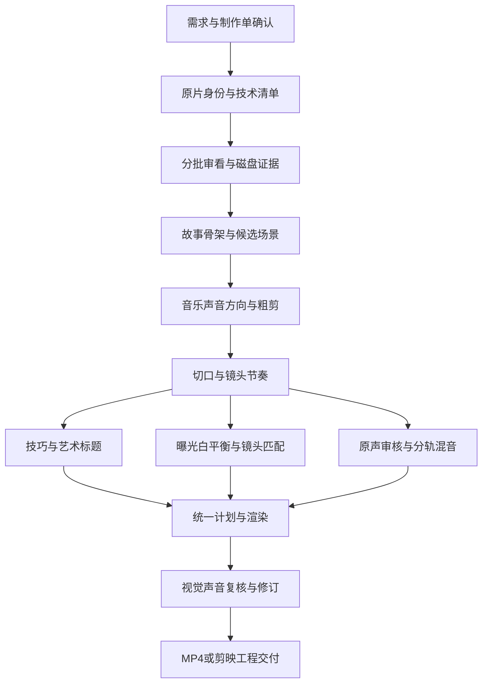

# Video Edit 宏观笔记与专题导航

整理日期：2026-10-14。知识与实现基线：2.3.1。这里整理已有学习、实现与实验结论；不是重新阅读全文书籍、连续观看全部教程或重新试听所有声音的记录。

## 整体框架

一个完整作品同时依赖三条主线：素材和证据决定哪些事实可信；故事和节奏决定观众为什么继续看；技巧、标题、颜色和声音决定这些内容如何被感知。模型负责审看与编辑判断，脚本负责可表达的时间、图层、媒体处理和校验。

这里的先后是依赖关系。选曲可以提前准备，标题与声音可以分工；最终节奏仍需回到真实动作、对白与乐句。某项没有可用工具就保留待验证状态，不用下一个阶段的成功掩盖它。

## 子专题

| 笔记 | 回答的问题 | 主要产物 |
|---|---|---|
| [01 故事线与节奏](01-story-and-rhythm.md) | 素材怎样形成观看理由，哪里值得停留或切换？ | 故事稿、场景卡、剪口与保护区 |
| [02 剪辑技巧与代码表达](02-editing-and-techniques.md) | 剪映操作怎样变成带单位的图层和时间关系？ | 技巧卡、spec、原生或派生资产 |
| [03 艺术标题与主题](03-art-titles-and-theme.md) | 怎样生成有主次、有字势、适合画面的标题？ | 透明字图、独立配件、运动表与审看记录 |
| [04 调色与画质](04-color-and-image.md) | 输入空间、镜头连续性和外观怎样衔接？ | 色彩声明、校正、20配方与导出检查 |
| [05 配乐方法](05-music-scoring.md) | 每段音乐承担什么任务，怎样选曲和留白？ | 声音提示表、候选试听、乐句与源时码 |
| [06 原声、配音与混音](06-audio-and-mixing.md) | 哪些声音值得保留，怎样保证语言与音量？ | 听审记录、独立音轨、响度与混音报告 |
| [07 素材记忆与子任务](07-material-memory-and-handoff.md) | 200段素材怎样在短上下文里可靠检索和交接？ | 磁盘索引、批次合同、阶段缓存与事实表 |
| [08 验证与性能基准](08-evaluation-and-benchmarks.md) | 怎样分别验证代码正确、流程可用和作品质量？ | 固定输入、反例测试、实测与盲评计划 |
| [09 工程、接口与交付](09-engineering-and-delivery.md) | 如何保留原片、可编辑边界和搬迁后的工程？ | 唯一计划、MP4、工程包、交付报告 |

## 目前积累到哪里

31课整理出77项知识抽象；31个代表案例走过代码渲染、完整解码与抽样审看，路线记录为15个原生、13个混合、3个整段派生。每课一个案例不证明77项逐项复刻。

公开200段库已经下载、核对哈希和完整解码，并用于分批分析与主题短片；它仍缺剪辑师标注的关键时刻真值和固定任务盲评。艺术标题实验完成20段4秒片段、20张透明标题及80秒汇总，最终60张输出抽帧经过独立Agent视觉复核，源片、字图、视频与审看帧绑定哈希。

2.3.1已有本机252项回归：251通过，1项因旧蒙版缓存依赖跳过；另有真实合成、SAR、曲线旋转和本机DLL回读。标题汇总工程保留5类轨、99段，28749个关键帧样本与最终单段一致。完整听审、剪映打开/播放/编辑/保存对照及观众盲评仍待完成。具体范围见[证据摘要](evidence-summary.json)与[版本验证记录](../references/validation-status.md)。

## 笔记如何进入实际任务

先按[Skill入口](../SKILL.md)保留完整流程，再按当前阶段读一个专题及其必要接口。笔记提供判断理由，JSON提供明确执行参数，实际输出提供验证依据。不能把笔记里的建议直接当作导出器支持字段，也不能把课程名称当成已经产生的效果。

后续优先级沿用已有思路：维护缓存与证据一致性，冻结真实素材基准，针对实际失败补检索、声音和调色；再用同一制作单比较版本。新增能力要同时更新对应专题、接口和验证状态，历史实验记录保留原来的条件与限制。
